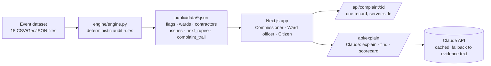

# Follow the Rupee · रुपयाचा मागोवा: Monsoon Road-Repair Ledger

**Where did Mumbai's road-repair money go, did the fix last, and where should the next rupee go?**
Built at Claude Impact Lab Mumbai (21 Nov 2026) on the event's synthetic dataset.

> ⚠️ Proposed audit layer for BMC's Roads Department · prototype on the event's synthetic dataset · **not an official BMC service**. All contractors are fictional. A flag is a risk signal for review, not proof of wrongdoing.

## Who it's for: one ledger, three views
| Role | Question it answers | What they can do |
|---|---|---|
| **Commissioner** (city) | Which wards and contractors need attention? | Compare all 24 wards, review budget reallocation suggestions, check contractor scores with fairness checks |
| **Ward officer** (Assistant Commissioner / Executive Engineer) | What do I act on today, and can I defend it? | Work through the flags (paid twice, over rate card, paid during warranty) with their evidence; move each flag through New → Under review → Contested by contractor → Recovered or Dismissed; **draft an escalation note** in BMC office-note format; see citizen follow-ups; use the next-rupee plan |
| **Citizen** | What happened to my complaint? | Look up a complaint ID or describe the problem in English, Marathi or Hindi, follow the complaint → repair → bill trail (including "Open for N days" and any ward office action), get an explanation in their own language, **submit a follow-up** with a reference number, browse their ward's report card |

## Headline findings (from the dataset)
- **₹1.69 Cr flagged across 621 work orders** (₹13.4 Cr total spend, 2,499 work orders).
- **109 bills above the rate card.** They're billed 1.5–3.1× the standard rate, against a normal range of 0.75–1.30×. There's a near-empty gap between the two, so these aren't normal variation.
- **45 possible double bills.** Each is a near-exact copy of an earlier job (same road, method, contractor and area, billed 1–4 days later) with no citizen complaint linked.
- **270 repairs paid during the warranty period** (road surface defects BMC paid for while the road was still under warranty), plus 217 drainage jobs on warranty roads flagged for review.
- **Re-open rates differ by contractor, not by weather.** Rain explains only a 2.4-point spread and flood-prone wards 3.7 points, against a 29.7-point spread between contractors.
- **6 wards overspent their budget and 6 used less than 80% of it.** The reallocation suggestion is computed from the data.

## Architecture

**Design principle: code finds the problems; Claude explains them.** Over-billing, duplicate and warranty checks are arithmetic, so they're exact, repeatable and free. Claude is used where it adds value: plain-language explanations in English, Marathi and Hindi, and reading messy multilingual complaints (for example, "dharavi मध्ये पाणी साचले आहे" → Dharavi, ward G/N, waterlogging). If the Claude call fails, the app falls back to the evidence text, so the demo never breaks.

## How each flag works
| Flag | Rule | Why this rule |
|---|---|---|
| Billed above rate card | cost ≥ 1.5× rate card (per sqm × area, or per job) | Normal range is 0.75–1.30×. Jobs between 1.30× and 1.50× go on a watch list instead |
| Possibly paid twice | unlinked job copying an earlier job (same road, method, contractor, area; cost within 10%; within 10 days) | Requiring no linked complaint avoids flagging genuine repeat repairs |
| Paid during warranty | road surface repair on a road under the Defect Liability Period | That repair is the original contractor's liability |
| Check: drainage on warranty road | drainage job on a warranty road | Lower tier: usually not a pavement defect, so no blame without context |

**Next rupee:** open complaints are cleaned (spam removed), linked to roads (road name in the text, then GPS, then locality), grouped into 217 road-level issues, and ranked by risk: severity, flood hotspots and tides, traffic, accidents, hospital and school access, and repeat failures. Each issue gets the repair method with the lowest **cost per repair that lasts**. Warranty roads go back to the original contractor at ₹0 to BMC.

## Writes that show up across roles
When a ward officer changes a flag's status, the citizen's trail shows that ward office action and the commissioner's "Actions taken" card updates. When a citizen submits a follow-up, it appears in the ward officer's drawer. *Demo: stored in the browser. In production: written to BMC's systems through the same API.*

## Robustness checks (we tested our own rules)
| Check | Result |
|---|---|
| Over-billing count at 1.3× / 1.4× / **1.5×** / 1.6× / 1.8× / 2.0× | 118 / 111 / **109** / 104 / 82 / 64. The rule sits in a real gap |
| Duplicates with the window widened to 30 days and cost to 25% | Still 45. All 45 unlinked work orders in the dataset are these copies |
| Re-open rate by road type | 23.7–28.1%. Every contractor gets a similar road-type mix, and the ranking holds within each type |
| Warranty flags with a utility-trench engineer remark | 37 of 270, shown with a **possible other cause**; the escalation note routes them to the utility agency, not the contractor |

## Fits BMC's existing process
- Adds an audit layer to BMC's existing systems (the Pothole Tracking System, the Measurement Book and the Unified Schedule of Rates). It doesn't replace any of them.
- The complaint trail could supply status replies for BMC's existing WhatsApp assistant (MyBMC Assist) rather than building a new channel.
- Accessibility follows India's UX4G and GIGW 3.0 standards: WCAG 2.1 AA, A−/A/A+ text size, English/मराठी/हिंदी, keyboard navigation, readable at 200% zoom.
- Every decision and the reason for it are in **[DECISIONS.md](DECISIONS.md)** (D1–D111). Design rules are in [DESIGN.md](DESIGN.md). [SPEC.md](SPEC.md) is the original build spec.

## Run it
```bash
npm install
echo "ANTHROPIC_API_KEY=..." > .env.local
npm run dev            # http://localhost:3000/?role=commissioner
# Re-run the audit from the raw dataset:
python3 engine/engine.py <path-to-dataset-repo> public/data
```

## Roadmap (after the event)
Intake form for walk-in and offline complaints (Claude structures them and spots duplicates, then forwards them to CCRS) · Claude compares before and after repair photos · next-rupee plans capped by each ward's crew capacity (`engineering_crews`) · Role-based access through BMC sign-in · contractors can contest a flag with evidence · live data from the Pothole Tracking System and SAP · a digital Measurement Book check · production UI on the official UX4G package.
